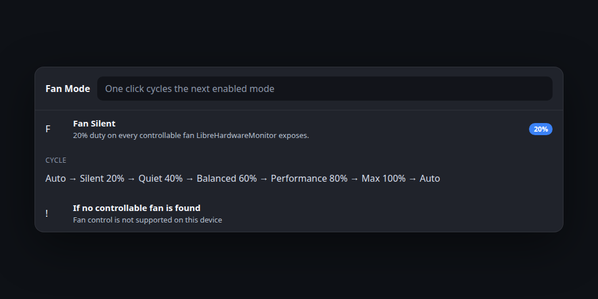

# HW Monitor

[](LICENSE)
[](https://github.com/ondery/hwmonitor/releases)
[](https://github.com/ondery/hwmonitor)

Live usage and temperature for every detected CPU and GPU, inside Windows Command Palette and on the Command Palette Dock.


HW Monitor is an open-source [Command Palette](https://learn.microsoft.com/windows/powertoys/command-palette/overview) extension. It is aimed at machines like an Intel Core i7-11800H with Intel UHD graphics and an NVIDIA GeForce RTX 3060 Laptop GPU, and it also covers other Intel, AMD, and NVIDIA adapters that LibreHardwareMonitor can see.

The pictures in this README are design mockups rendered in a dark Windows 11 style. Real screenshots from Command Palette will replace them after the first Windows release.

## Features

- One list row per detected processor package, core, and graphics adapter, with usage and temperature.
- Live refresh, default 1 second, configurable from 500 to 3000 ms.
- Dock chips such as `CPU 27% · 58°C`, plus pinnable Cool Mode and Fan Mode items.
- Four temperature colors (blue, yellow, orange, red) with editable thresholds and hex colors.
- Cool Mode limits the active power scheme’s maximum processor state, then restores the original values.
- Fan Mode cycles named duty presets on controllable fans and returns control to firmware on Auto and on exit.
- English UI strings live in `src/HWMonitor.Core/Resources/Strings.resx`, so more languages can be added later.

## Screenshots

### Dock


### Sensor list


### Settings


### Cool Mode


### Fan Mode



### Color levels


## Install

After the package is published:

```powershell
winget install Ondery.HWMonitor
```

Command Palette discovers extensions tagged `windows-commandpalette-extension`. Until that listing exists, install a release build by hand:

1. Download `HWMonitor-Setup-<version>-x64.exe` or the ARM64 installer from [Releases](https://github.com/ondery/hwmonitor/releases).
2. Run the installer. It registers the COM local server for the current user.
3. Restart Command Palette if it was already open. Search for **HW Monitor**.

Uninstall from Windows Settings. The installer removes the COM registration.

## Usage

Open Command Palette and run **HW Monitor**. The page lists:

- **Cool Mode** and **Fan Mode**
- Each CPU package and, unless compact mode is on, each core
- Each Intel, AMD, or NVIDIA GPU

Dock support uses `GetDockBands` and `WrappedDockItem` from Command Palette Extension SDK 0.12 (`ICommandProvider3` / `ICommandProvider4`, available since SDK 0.9). Enable the Dock in Command Palette settings (Dock, also shown as Yuva in some preview builds) and add the HW Monitor band. The band contains one chip per CPU and GPU, then Cool Mode and Fan Mode.

`GetCommandItem` resolves the same ids, so a single sensor, Cool Mode, or Fan Mode can be pinned on its own. Sensor chips open the list. Cool Mode toggles. Fan Mode cycles.

Temperatures are colored with a tag: Cool, Warm, Hot, or Critical.

## Settings

| Setting | Default | What it does |
| --- | --- | --- |
| Refresh interval | 1000 ms | Clamped to 500–3000 |
| Compact sensor list | Off | Hides per-core rows. Dock items stay one per device |
| Blue below | 60 °C | Blue under the yellow threshold. Color `#3B82F6` |
| Yellow from | 60 °C | Color `#EAB308` |
| Orange from | 75 °C | Color `#F97316` |
| Red from | 90 °C | Color `#EF4444` |
| Cool Mode processor cap | 99% | Maximum processor state while Cool Mode is on |
| Also set processor boost mode | On | Disabled, or Efficient |
| Auto Cool Mode | Off | Arms automatic Cool Mode |
| Auto Cool on at | 85 °C for 10 s | Activates only after the package stays this hot |
| Auto Cool off at | 70 °C for 10 s | Restores the scheme after it stays this cool |
| Fan mode 1–5 | Silent 20, Quiet 40, Balanced 60, Performance 80, Max 100 | Name, duty, and enabled flag |
| Experimental MSI EC probe | Off | Identifies the model only. It does not write EC registers |

If fewer than two fan modes would remain enabled, the change is rejected and the Fan Mode row reports `At least two fan modes must stay enabled.`

## Cool Mode

Cool Mode is the laptop-style turbo limit used by many “CPU cooler” utilities.

On the **active** Windows power scheme it sets **Maximum processor state** (`PROCTHROTTLEMAX`, AC and DC) to the configured cap. The default, 99%, disables turbo boost on most Intel and AMD processors while leaving the CPU usable. Optionally it also sets **Processor performance boost mode** (`PERFBOOSTMODE`) to Disabled (`0`) or Efficient (`3`). The scheme is reapplied with `powercfg /setactive`.

Before anything is changed, the original AC and DC indexes are saved. They are written back when:

- you turn Cool Mode off
- the extension exits
- the process did not exit cleanly, on the next start

Auto Cool Mode turns the cap on only after the CPU package stays at or above the high threshold for N seconds, and turns it off after the package stays at or below the low threshold for N seconds. A manual Cool Mode session is not turned off by the automatic low threshold.

If Windows denies the change, Cool Mode stays off and the row says: **Cool Mode could not change the active power scheme. Start Command Palette as administrator and try again.**

Cool Mode does not install a driver. It only edits the active power scheme, and only while it is on.

## Fan Mode

Each click moves to the next **enabled** preset and the dock chip shows that name (`Fan Silent`, `Fan Quiet`, …). After the last enabled preset, the next click is **Fan Auto**, which hands the fans back to firmware.

Duty is applied with LibreHardwareMonitor `ISensor.Control.SetSoftware` on every fan control it exposes (pump controls are skipped). `SetDefault` restores firmware control for Auto, exit, and crash recovery on the next launch. Disabled presets are skipped. At least two presets must stay enabled.

If LibreHardwareMonitor exposes no controllable fan, the command does not pretend to change anything. It shows:

> Fan control is not supported on this device

### MSI laptops

Many MSI laptops, including the Creator Z16 A11UET, only expose fans through the embedded controller. The Linux `msi-ec` driver documents per-firmware maps. A related model, Creator Z16 A11UE firmware `1571EMS1.106`, matches layout CONF14. That layout’s constant fan-duty register is explicitly unsupported (`MSI_EC_ADDR_UNSUPP`). Creator Z16 **A11UET** is not on the allow-list.

LibreHardwareMonitor also documents that writing ACPI EC ports from Windows races with firmware. HW Monitor therefore does **not** write EC bytes. The experimental toggle is off by default. When it is on, the separate `MsiEcFanBackend` only reads the product name and explains why that model is refused. Fan duty still comes only from LibreHardwareMonitor controls.

Stopping a fan (0% duty) can overheat a laptop. Prefer the built-in presets, use Auto when you are done, and rely on exit recovery if Command Palette closes unexpectedly.

## Temperature permissions

CPU and GPU **usage** comes from LibreHardwareMonitor when it can read load sensors, and otherwise from Windows performance counters (`Processor Information` / `Processor`, and `GPU Engine` 3D). Usage does not need an extra kernel driver.

**Temperatures** on modern CPUs need a kernel driver. This extension uses LibreHardwareMonitor 0.9.6, which talks to hardware through [PawnIO](https://pawnio.eu/) rather than the deprecated WinRing0 driver. NVIDIA temperatures and loads are read through NVML/NVAPI by that library. Intel graphics temperature may come from the processor’s graphics sensor when the GPU itself has no reading.

If PawnIO is missing, or the process cannot use it, temperatures show as `n/a` and a status row explains that. Install PawnIO, then restart Command Palette. Do not install WinRing0.

## Build

Requirements: .NET 9 SDK, Windows 10/11 SDK (the project compiles against 10.0.22621 because `Shmuelie.WinRTServer` targets Windows 10.0.22000), and [Inno Setup 6](https://jrsoftware.org/isinfo.php) for the installer.

```powershell
dotnet test src\HWMonitor.Tests\HWMonitor.Tests.csproj
dotnet build hwmonitor\HWMonitor.csproj -c Release
cd hwmonitor
.\build-exe.ps1 -Version 0.1.0.0
```

The test project is plain .NET 9 and does not need Windows. The extension project runs `cswinrt.exe`, so build it on Windows.

`build-exe.ps1` publishes self-contained `win-x64` and `win-arm64` builds and compiles `HWMonitor-Setup-<version>-x64.exe` and the ARM64 installer. Trimming is off because LibreHardwareMonitor is not trim-safe.

The extension project targets `net9.0-windows10.0.22621.0` with a minimum supported OS of 10.0.19041. The WinRT server library itself is built for Windows 10.0.22000, so use Windows 11 for a real run.

GitHub Actions workflow `release-extension.yml` runs the same build on `windows-2022` with .NET 9 and Inno Setup. `update-winget.yml` submits later updates after a release named `HWMonitor Extension v…`.

SDK: `Microsoft.CommandPalette.Extensions` **0.12.260812002**. A 0.13 package was not on NuGet at the time this project was created. Dock bands shipped in 0.9 and are part of 0.12, which Command Palette 0.13 hosts load.

COM class id: `37dd9813-4cb9-458b-bc43-41e89443f396`  
WinGet package id: `Ondery.HWMonitor`  
Installer AppId: `{C9C07999-73E6-498F-AD96-049A06D708DE}`

Draft WinGet manifests are in `winget/`. Replace the placeholder SHA256 values with the release installers before `wingetcreate submit`. The first submission is manual; later releases can use the update workflow. The dependency is `Microsoft.WindowsAppRuntime.1.8`.

## Credits

Sensor access uses [LibreHardwareMonitor](https://github.com/LibreHardwareMonitor/LibreHardwareMonitor) `LibreHardwareMonitorLib` 0.9.6 (MPL-2.0). HW Monitor’s own code is MIT, Copyright (c) 2026 Ondery.

MSI EC behavior was checked against the Linux [msi-ec](https://github.com/torvalds/linux/blob/master/drivers/platform/x86/msi-ec.c) driver and the [BeardOverflow/msi-ec](https://github.com/BeardOverflow/msi-ec) notes. Those maps are not used to write registers.

## License

MIT. See [LICENSE](LICENSE).
