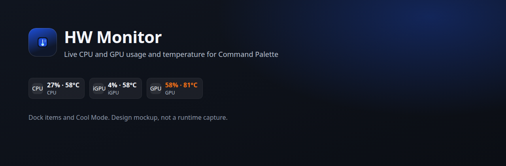
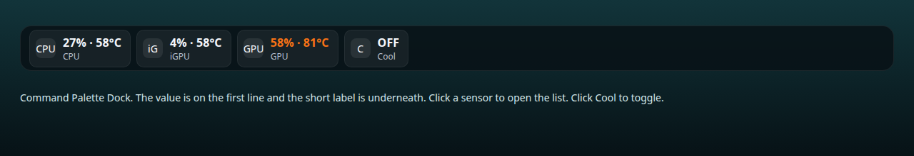
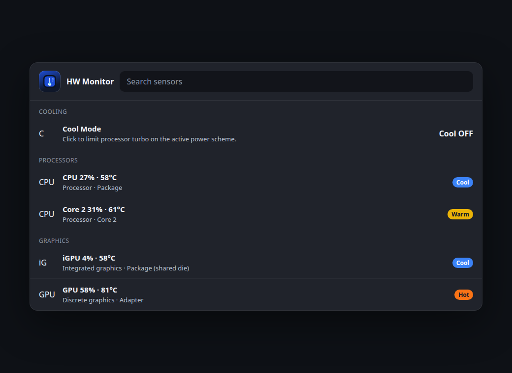
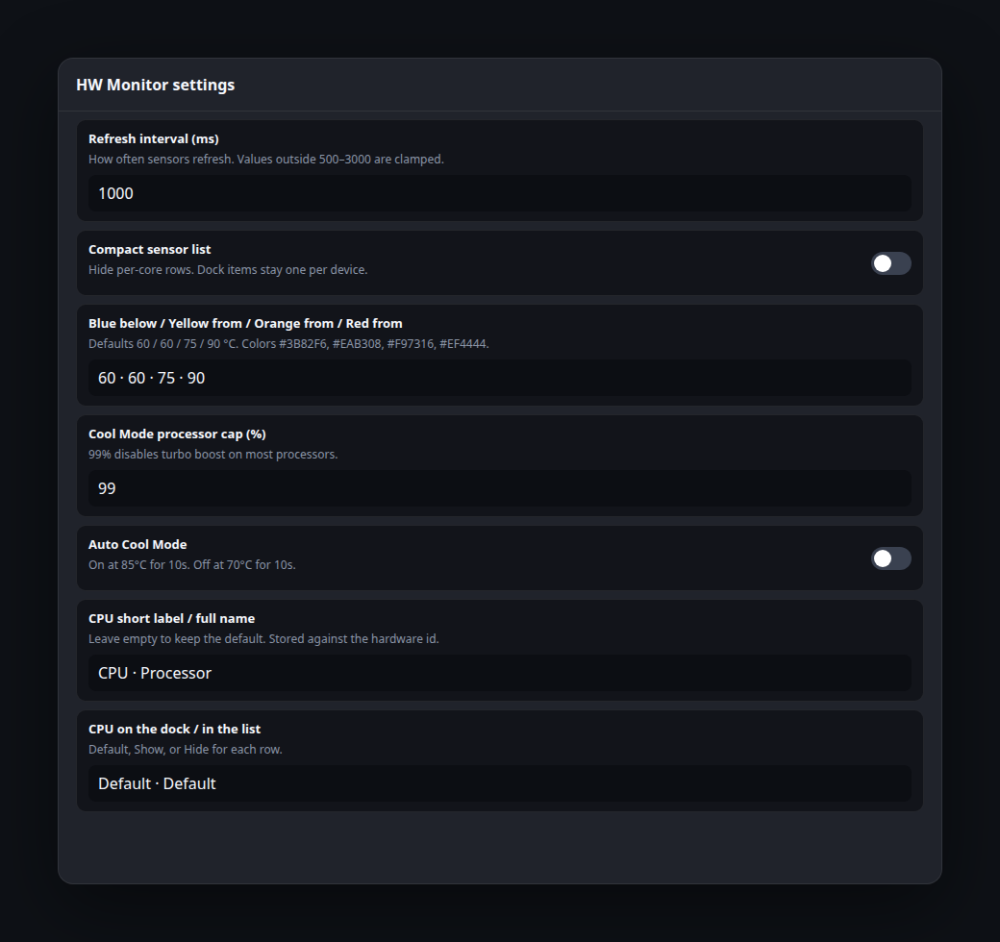
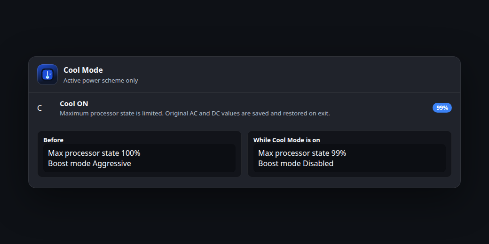
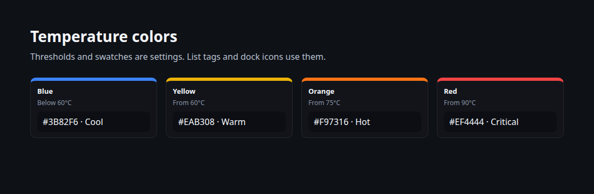

# HW Monitor

[](LICENSE)
[](https://github.com/ondery/hwmonitor/releases)
[](https://github.com/ondery/hwmonitor)

Live usage and temperature for every detected CPU and GPU, inside Windows Command Palette and on the Command Palette Dock.



HW Monitor is an open-source [Command Palette](https://learn.microsoft.com/windows/powertoys/command-palette/overview) extension. It follows whatever processors and graphics adapters LibreHardwareMonitor can see: one or more Intel or AMD CPUs, and any number of NVIDIA, AMD, or Intel GPUs, on desktops and laptops. Integrated graphics that do not have a temperature sensor of their own show the processor package temperature.

The pictures in this README are design mockups rendered in a dark Windows 11 style. Real screenshots from Command Palette will replace them after the first Windows release.

## Features

- One list row per detected processor package, core, and graphics adapter, with usage and temperature.
- Rows appear and disappear as devices are detected. Missing sensors stay blank instead of failing the page.
- Live refresh, default 1 second, configurable from 500 to 3000 ms.
- Dock items use two lines, the same shape as the built-in Performance Monitor item: the value on top (`55% · 72°C`) and a short label underneath (`CPU`, `GPU`, `iGPU`).
- Each row's short label, optional full name, and list/dock visibility can be changed in settings. The choice is stored against the sensor library's hardware id.
- Four temperature colors (blue, yellow, orange, red) with editable thresholds and hex colors.
- Cool Mode limits the active power scheme’s maximum processor state, then restores the original values.
- English UI strings live in `src/HWMonitor.Core/Resources/Strings.resx`, so more languages can be added later.

## Screenshots

### Dock



### Sensor list



### Settings



### Cool Mode



### Color levels



## Install

After the package is published:

```powershell
winget install Ondery.HWMonitor
```

Command Palette discovers extensions tagged `windows-commandpalette-extension`. Until that listing exists, install a release build by hand:

1. Download `HWMonitor-Setup-<version>-x64.exe` or the ARM64 installer from [Releases](https://github.com/ondery/hwmonitor/releases).
2. Run the installer. It registers the COM local server for the current user.
3. Restart Command Palette if it was already open. Search for **HW Monitor**.

Uninstall the extension from Windows Settings. The installer removes the COM registration.

That install is enough for usage, NVIDIA and AMD graphics temperatures that the library can read without a kernel driver, and Cool Mode. Processor package temperature on a normal Command Palette process needs the sensor service below.

## Sensor service

Command Palette starts the extension at medium integrity. LibreHardwareMonitor 0.9 reads modern CPU package and core temperatures through the [PawnIO](https://pawnio.eu/) driver, and opening that driver from a medium-integrity process fails. Graphics adapters that the library can read in-process, including many NVIDIA adapters, still report a temperature. Intel and AMD integrated graphics usually do not have a separate die sensor, so they need the processor package temperature as well.

HW Monitor Sensor Service is a small separate program that runs as LocalSystem. It reads CPU and GPU load and temperature sensors and answers one read-only request on a local named pipe. The extension uses the service when the pipe accepts a connection, and otherwise keeps its in-process readers. When the service is not running and a processor or integrated GPU has no temperature, the list says **Install sensor service for CPU temperature** instead of leaving only `n/a`.

The service does not write embedded-controller ports or vendor control methods. Cool Mode stays in the extension and only changes the active Windows power scheme.

### Install the service

From an elevated PowerShell prompt, or from a normal prompt that can show the UAC dialog:

```powershell
cd path\to\hwmonitor
.\scripts\install-sensor-service.ps1
```

The script:

1. Asks for administrator approval if the window is not already elevated.
2. Publishes `src/HWMonitor.SensorService` (or copies `-SourceDir` when you already have a published folder).
3. Copies the files to `C:\Program Files\Ondery\HWMonitor\SensorService`.
4. Installs PawnIO when it is missing. It checks the winget id `namazso.PawnIO` with `winget show` before installing. The current winget package is published by namazso and installs the signed driver from [pawnio.eu](https://pawnio.eu/).
5. Registers service `HWMonitorSensorService`, display name **HW Monitor Sensor Service**, start mode Automatic, account LocalSystem, and starts it.

Useful switches:

```powershell
.\scripts\install-sensor-service.ps1 -Platform arm64
.\scripts\install-sensor-service.ps1 -SourceDir C:\publish\sensor-service
```

Remove it with:

```powershell
.\scripts\uninstall-sensor-service.ps1
```

Uninstall stops and deletes the service and deletes the program folder. It does not remove PawnIO, because other tools may be using that driver.

`scripts/sensor-service.iss` is an optional Inno Setup 6 script for the same service. Publish the service into `scripts/stage/win-x64` first, then compile the script on Windows. It does not install PawnIO. The PowerShell script is the path that checks the winget package.

### Pipe

| | |
| --- | --- |
| Pipe | `\\.\pipe\Ondery.HWMonitor.Sensors` |
| Service name | `HWMonitorSensorService` |
| Display name | HW Monitor Sensor Service |
| Account | LocalSystem |
| Direction | One request per connection. The only operation is `get`. |

Each message is a 4-byte little-endian length followed by UTF-8 JSON. Payloads larger than 256 KiB are rejected.

Request:

```json
{"v":1,"op":"get"}
```

Response:

```json
{"v":1,"ok":true,"capturedUtc":"2026-11-08T00:00:00Z","error":null,"sensors":[]}
```

Each sensor object has `hardwareId`, `hardwareName`, `kind` (`cpu` or `gpu`), `gpuClass` (`none`, `integrated`, or `discrete`), `sensorName`, `metric` (`load` or `temperature`), and `value`. Any `op` other than `get` returns `ok: false` and does not read hardware. The pipe ACL gives LocalSystem full control and lets Authenticated Users connect, read, and write. Write access exists only so the client can send `get`.

### What to check on the PC

1. `Get-Service HWMonitorSensorService` reports Running.
2. After PawnIO is installed, restart the service once if temperatures are still empty.
3. Command Palette shows a package temperature on the CPU row. An integrated GPU with no sensor of its own uses that same temperature and the role **Package (shared die)**.
4. A discrete GPU keeps its own temperature when the library reports one.
5. With the service stopped, the CPU row no longer shows a bare `n/a`; the list explains that the sensor service is required.

## Usage

Open Command Palette and run **HW Monitor**. The page lists:

- **Cool Mode**
- Each CPU package and, unless compact mode is on, each core
- Each Intel, AMD, or NVIDIA GPU, integrated or discrete

Dock support uses `GetDockBands` and `WrappedDockItem` from Command Palette Extension SDK 0.12 (`ICommandProvider3` / `ICommandProvider4`, available since SDK 0.9). Enable the Dock in Command Palette settings and add the HW Monitor band. The band contains one item per visible CPU and GPU, then Cool Mode.

`GetCommandItem` resolves the same ids, so a single sensor or Cool Mode can be pinned on its own. Sensor items open the list. Cool Mode toggles.

Dock text is two lines. The title is the value, for example `55% · 72°C`. The subtitle is the short label, for example `CPU`, `GPU`, or `iGPU`. A second adapter of the same kind is `GPU 2`. The fixed `18ch` title width is not set. Width uses the same extended properties as PowerToys Performance Monitor:

- `Microsoft.CommandPalette.Dock.TitleWidth` = `text:100% · 100°C`
- `Microsoft.CommandPalette.Dock.SubtitleWidth` = `text:` plus the short label
- `Microsoft.CommandPalette.Dock.TabularDigits` = true

SDK 0.12.260812002 does not include `SetDockLabelReservations`, so the extension writes those keys itself. A host that does not understand the `text:` sample form ignores it, and the item then sizes to the text that is actually shown. Temperature color tags stay on the list and on the dock.

## Settings

| Setting | Default | What it does |
| --- | --- | --- |
| Refresh interval | 1000 ms | Clamped to 500–3000 |
| Compact sensor list | Off | Hides per-core rows unless that row is set to Show |
| Blue below | 60 °C | Blue under the yellow threshold. Color `#3B82F6` |
| Yellow from | 60 °C | Color `#EAB308` |
| Orange from | 75 °C | Color `#F97316` |
| Red from | 90 °C | Color `#EF4444` |
| Cool Mode processor cap | 99% | Maximum processor state while Cool Mode is on |
| Also set processor boost mode | On | Disabled, or Efficient |
| Auto Cool Mode | Off | Arms automatic Cool Mode |
| Auto Cool on at | 85 °C for 10 s | Activates only after the package stays this hot |
| Auto Cool off at | 70 °C for 10 s | Restores the scheme after it stays this cool |
| Short label, full name, list, dock | Per device | Shown after the first sensor refresh. Empty names keep the default |

Device choices are saved in the extension settings and in `device-presentation.json` beside `settings.json`. The key is the reading id, which contains the LibreHardwareMonitor hardware identifier (for example a package id or a package id plus a core number). Renames survive restarts while that identifier stays the same. Adding or removing a device can change library indexes, so a label may need to be set again after the hardware layout changes.

List visibility defaults to on for packages and adapters, and to off for cores while compact mode is on. Dock visibility defaults to on for packages and adapters, and off for cores. **Show** and **Hide** override that default. **Default** follows the rule above.

## Cool Mode

Cool Mode is the laptop-style turbo limit used by many processor utilities. It works on desktops as well. It only edits the active Windows power scheme.

On the **active** Windows power scheme it sets **Maximum processor state** (`PROCTHROTTLEMAX`, AC and DC) to the configured cap. The default, 99%, disables turbo boost on most Intel and AMD processors while leaving the CPU usable. Optionally it also sets **Processor performance boost mode** (`PERFBOOSTMODE`) to Disabled (`0`) or Efficient (`3`). The scheme is reapplied with `powercfg /setactive`.

Before anything is changed, the original AC and DC indexes are saved. They are written back when:

- you turn Cool Mode off
- the extension exits
- the process did not exit cleanly, on the next start

Auto Cool Mode turns the cap on only after the CPU package stays at or above the high threshold for N seconds, and turns it off after the package stays at or below the low threshold for N seconds. A manual Cool Mode session is not turned off by the automatic low threshold.

If Windows denies the change, Cool Mode stays off and the row says: **Cool Mode could not change the active power scheme. Start Command Palette as administrator and try again.**

Cool Mode does not install a driver. It only edits the active power scheme, and only while it is on.

## Temperature permissions

CPU and GPU **usage** comes from LibreHardwareMonitor when it can read load sensors, and otherwise from Windows performance counters (`Processor Information` / `Processor`, and `GPU Engine` 3D). Usage does not need an extra kernel driver.

**Temperatures** on modern CPUs need a kernel driver. LibreHardwareMonitor 0.9.6 talks to hardware through PawnIO rather than the deprecated WinRing0 driver. The sensor service is the process that opens PawnIO. NVIDIA, AMD, and Intel discrete temperatures are shown when that library reports them. An integrated GPU with its own temperature sensor keeps that reading. Otherwise the row reuses the paired processor package temperature and labels the role **Package (shared die)**. With more than one processor, the first integrated GPU follows the first package, the next follows the next package, and any further integrated GPU follows the first package that has a temperature.

Integrated versus discrete is not a fixed list of product names. A device is integrated when the sensor library's type or identifier says so, or when the matching display adapter has less than 1 GiB of dedicated video memory. NVIDIA adapters stay discrete. Intel graphics marked discrete by the library stay discrete.

If the service is running and temperatures are still missing, install PawnIO and restart the service. Do not install WinRing0.

## Store package

The extension project builds an MSIX (`EnableMsixTooling=true`, `Package.appxmanifest`) so it can be submitted to the Microsoft Store. That manifest does **not** register the sensor service.

A packaged service would need the restricted capabilities `packagedServices` and `localSystemServices`, declared with `desktop6:Service` and `StartAccount="localSystem"`. Store certification normally rejects `localSystemServices` unless Microsoft grants a specific exception. An MSIX also cannot install the PawnIO kernel driver. The service would still depend on a separate driver install, so packaging it does not remove the administrator step.

`Package.with-service.appxmanifest` is the opt-in variant. Build it with:

```powershell
dotnet build hwmonitor\HWMonitor.csproj -c Release -p:Platform=x64 -p:IncludePackagedSensorService=true -p:SensorServicePublishDir=path\to\published\service
```

`SensorServicePublishDir` copies a published service folder into the package layout. Leave the flag unset for Store and sideload builds. The separate installer is the default.

## Build

Requirements: .NET 10 SDK, Windows 10/11 SDK, and [Inno Setup 6](https://jrsoftware.org/isinfo.php) for the extension installer.

```powershell
dotnet test src\HWMonitor.Tests\HWMonitor.Tests.csproj
dotnet build hwmonitor.sln -c Release -p:Platform=x64
cd hwmonitor
.\build-exe.ps1 -Version 0.1.0.0
```

The test project is plain .NET and does not need Windows. The extension, hardware reader, and sensor service target `net10.0-windows10.0.26100.0`. `EnableWindowsTargeting` is set so the Windows projects can compile on a non-Windows SDK when the targeting pack is installed. Run them on Windows.

`build-exe.ps1` publishes self-contained `win-x64` and `win-arm64` builds of the extension and the sensor service, and compiles `HWMonitor-Setup-<version>-x64.exe` and the ARM64 installer. Trimming is off because LibreHardwareMonitor is not trim-safe. The extension installer does not register the service; run `scripts/install-sensor-service.ps1` after installing the extension.

The extension project targets `net10.0-windows10.0.26100.0` with a minimum supported OS of 10.0.19041. The WinRT server library itself is built for Windows 10.0.22000, so use Windows 11 for a real run.

GitHub Actions workflow `release-extension.yml` runs the same build on `windows-2022` with .NET 10 and Inno Setup. `update-winget.yml` submits later updates after a release named `HWMonitor Extension v…`.

SDK: `Microsoft.CommandPalette.Extensions` **0.12.260812002**. Dock bands shipped in 0.9 and are part of 0.12, which current Command Palette hosts load.

COM class id: `37dd9813-4cb9-458b-bc43-41e89443f396`  
WinGet package id: `Ondery.HWMonitor`  
Installer AppId: `{C9C07999-73E6-498F-AD96-049A06D708DE}`

Draft WinGet manifests are in `winget/`. Replace the placeholder SHA256 values with the release installers before `wingetcreate submit`. The first submission is manual; later releases can use the update workflow. The dependency is `Microsoft.WindowsAppRuntime.1.8`.

## Credits

Sensor access uses [LibreHardwareMonitor](https://github.com/LibreHardwareMonitor/LibreHardwareMonitor) `LibreHardwareMonitorLib` 0.9.6 (MPL-2.0). CPU temperature uses the [PawnIO](https://pawnio.eu/) driver from that library. HW Monitor’s own code is MIT, Copyright (c) 2026 Ondery.

## License

MIT. See [LICENSE](LICENSE).
